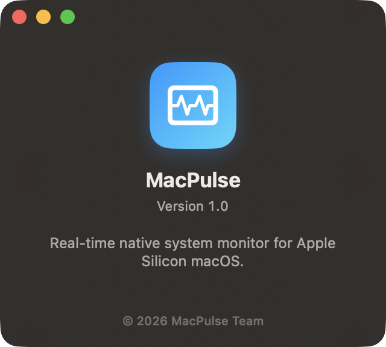
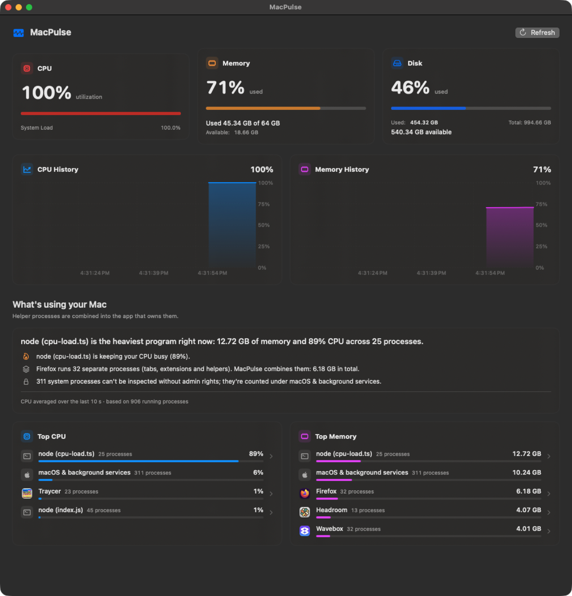

<div align="center">



# MacPulse

**A fast, native system monitor for Apple Silicon Macs that tells you, in plain English, what's actually slowing your Mac down.**

[](https://github.com/bytePatrol/MacPulse/releases/latest)
[](#requirements)
[](#requirements)
[](https://swift.org)
[](#architecture)
[](LICENSE)

[**Download**](https://github.com/bytePatrol/MacPulse/releases/latest) · [Features](#features) · [Installation](#installation) · [Build from source](#build-from-source) · [How it works](#how-it-works)

</div>

---



## Why MacPulse?

Activity Monitor shows you *processes*. A modern browser alone can run 30+ of them, and a dev server can spawn dozens of `node` workers, so the real answer to "what's eating my Mac?" is buried in a list of hundreds of rows.

MacPulse answers that question directly. It groups every helper process into the app that owns it, avoids double-counting shared memory, accounts for memory compression, and sums it all up in a single sentence, such as:

> **node (cpu-load.ts) is the heaviest program right now: 12.72 GB of memory and 89% CPU across 25 processes.**

It's a small, native SwiftUI app with no dependencies and no network access. Everything is computed on your Mac.

## Features

### Live system vitals
| | |
|---|---|
| **CPU** | Total utilization across all cores, computed from per-core kernel tick counters. |
| **Memory** | Used / total / available, using the same "Memory Used" formula as Activity Monitor. |
| **Disk** | Used / available / total for the startup volume, including purgeable space macOS can reclaim. |

- Refreshes every **2 seconds** from real kernel and file-system data. Nothing is estimated or simulated.
- Color-coded gauges for each metric, so you can read the state of your Mac at a glance.

### 60-second history charts
- Smooth **Swift Charts** area charts for CPU and memory over a sliding 60-second window.
- A fixed 0–100% axis keeps the scale steady, so spikes look like spikes. The time axis shows the time of day.

### "What's using your Mac?"
The main feature: a per-app breakdown that explains itself.

- **Helper processes are grouped into their app.** Firefox's 30+ content, GPU and extension processes become one **Firefox** row. Attribution uses macOS's own "responsible process" relationship rather than guessing from names.
- **A plain-English summary** names the heaviest program and adds short notes, such as which app is keeping your CPU busy, which app runs many separate processes, and how many system processes can't be inspected without admin rights.
- **Top CPU** and **Top Memory** lists with real app icons, proportional bars and process counts. Expand any row to see the individual processes inside it.
- **Command-line programs are named by their script.** Instead of five anonymous `node` entries you see `node (index.js)` and `node (cpu-load.ts)`. Scripts are identified from their arguments only. MacPulse never reads process environment variables, and inline code such as `node -e "…"` is never shown.
- **Programs launched from a terminal are attributed correctly.** A script started in Terminal, iTerm2, Warp, Ghostty, kitty, VS Code, Cursor or Zed is counted on its own, not under the app that launched it.
- **Busy system services get friendly names**, for example *Spotlight indexing*, *Time Machine backup*, *Photos analysis*, *iCloud sync* and *Software Update*.
- **Accurate memory numbers:**
  - **Shared memory is counted once.** A database such as PostgreSQL can map the same multi-gigabyte buffer into dozens of processes. MacPulse measures shared regions so that a single buffer isn't reported many times over.
  - **Memory compression is taken into account**, so per-app totals add up to what the system really uses.
  - **A number that isn't measured yet is never shown.** While shared memory is still being measured, the row says *measuring…* instead of an inflated figure.
- **Stable CPU numbers.** CPU per app is averaged over the last 10 seconds, so short bursts don't reorder the list every refresh.
- **Everything left over is still counted.** Memory and CPU from processes that can't be read without admin rights are shown as *macOS & background services*, so the totals stay honest.

### Native and polite
- 100% native **Swift + SwiftUI**, with no third-party dependencies, no Electron and no background daemons.
- Process scans run **off the main thread** (about 25 ms), so the interface stays responsive.
- Follows the system **Light / Dark appearance**.
- **Accessible**: VoiceOver labels and values for gauges, charts and list rows, and a clear heading hierarchy.
- Adaptive layout that switches between one and two columns as you resize the window.
- **⌘R** to refresh now, plus a standard **About MacPulse** window from the app menu.

### Private by design
MacPulse makes **no network connections**, has no analytics or telemetry, and needs **no special permissions or admin password**. It reads only the information macOS already provides to any app run by the current user.

## Installation

1. Download **`MacPulse-1.0.dmg`** from the [latest release](https://github.com/bytePatrol/MacPulse/releases/latest).
2. Open the DMG and drag **MacPulse** into **Applications**.
3. Launch MacPulse from Applications.

> [!NOTE]
> MacPulse is ad-hoc signed but not notarized by Apple, so Gatekeeper will block it the first time you open it. To allow it:
> - **macOS 15 Sequoia and later:** try to open the app once, then go to **System Settings → Privacy & Security**, scroll down and click **Open Anyway**.
> - **macOS 14 Sonoma:** right-click (or Control-click) **MacPulse.app**, choose **Open**, then confirm.
>
> Or, from Terminal: `xattr -dr com.apple.quarantine /Applications/MacPulse.app`

### Requirements
- A Mac with **Apple Silicon** (M1 or later)
- **macOS 14 Sonoma** or later

## Build from source

You need **Xcode 16** or later (Swift 6 toolchain).

```sh
git clone https://github.com/bytePatrol/MacPulse.git
cd MacPulse
./scripts/build-app.sh          # release build -> build/MacPulse.app (arm64, ad-hoc signed)
open build/MacPulse.app
```

`build-app.sh` uses `/Applications/Xcode.app` automatically, even when `xcode-select` points at the Command Line Tools.

To work on it in Xcode, open the package directly:

```sh
xed .                           # or: open Package.swift
```

Then choose the **MacPulse** scheme and run it.

### Running the tests

```sh
export DEVELOPER_DIR=/Applications/Xcode.app/Contents/Developer
swift test --no-parallel        # unit, integration and UI render tests
./scripts/smoke-test.sh         # builds the .app, launches it and checks it stays up
```

The suite has more than 100 XCTest cases. Live readings are cross-checked against `vm_stat`, `df` and `FileManager`. CPU accounting is tested under real multi-threaded load. Grouping and summary rules are tested with fixtures, and the dashboard is rendered in both Light and Dark mode.

## How it works

| Metric | Source |
|---|---|
| CPU % | `host_processor_info` per-core tick deltas between samples (avoids `host_statistics` rate limiting) |
| Memory | `host_statistics64` VM statistics: *app + wired + compressed*, matching Activity Monitor |
| Disk | `URLResourceValues.volumeAvailableCapacityForImportantUsage` for the startup volume |
| Process list | `proc_listallpids` + `proc_pid_rusage` / `PROC_PIDTASKINFO` (physical footprint, Mach CPU time) |
| App attribution | The system's *responsible process* relationship, resolved to the outermost `.app` bundle |
| Script names | `KERN_PROCARGS2` (arguments only; the environment is never parsed) |
| Shared memory | Region walks for processes that are likely to share memory, cached and run in the background |

## Architecture

MacPulse is a Swift Package with three modules:

```
Sources/
├── MacPulseCore/         # No UI. Models, provider protocols, live system services
│   ├── Interfaces/       # Models, ProcessModels, Providers (protocols)
│   └── Services/         # LiveProviders, MetricsStore, LiveProcessListProvider,
│                         # UsageAnalyzer, InsightsStore, ProcessArguments
├── MacPulseUI/           # SwiftUI: DashboardView, MetricCard, HistoryChartView,
│                         # UsageSummaryView, ConsumerListView, AboutView, Formatting
└── MacPulse/             # @main app: windows, menus, lifecycle
Tests/
├── MacPulseCoreTests/    # Model math, providers, stores, analyzer, argument parsing
└── MacPulseUITests/      # Formatting and Light/Dark render tests
```

- **`MetricsStore`** (`@Observable`, main actor) samples CPU, memory and disk every 2 s and keeps 60 s of history.
- **`InsightsStore`** scans processes off the main thread, keeps a 10 s window for CPU averaging and publishes a `UsageSummary`.
- **`UsageAnalyzer`** is a pure function from process snapshots to grouped consumers, a headline and insights, so it's easy to test with fixtures.
- Every data source sits behind a protocol (`SystemMetricsProviding`, `ProcessListProviding`). The UI and tests use mock providers, and the app uses the live ones.

## Contributing

Issues and pull requests are welcome. Before you open a PR, please run `swift test --no-parallel` and `./scripts/smoke-test.sh`, and keep each change focused on one topic.

## License

MacPulse is released under the [GNU General Public License v3.0](LICENSE).
